<div align="center">


<h3>The scoreboard of the TRSYP 3.0 robotics competition</h3>

<p>
  A live show on the venue's big screen, driven from a phone in the crowd.
</p>

<p>
  
  
  
  
  
</p>

<p>
  <a href="#-00--homologation"><b>Homologation</b></a> ·
  <a href="#-the-league"><b>League</b></a> ·
  <a href="#-the-champions-cup"><b>Cup</b></a> ·
  <a href="#-how-it-works"><b>How it works</b></a> ·
  <a href="#-running-the-show"><b>Run it</b></a>
</p>

</div>


## 🎬 The idea

Robots played head to head in front of the audience. Someone had to start the timers, follow every piece the robots
placed, apply the penalties and put the scores on the big screen, while walking around the arena. So the app is two
pages on two devices:

- **`/`, the big screen.** A 1920×1080 stage on the projector. It shows only the show: no buttons, no forms.
- **`/control`, the remote.** A phone. Every command and every score is entered here, privately, and reaches the
  screen only when the operator presses **Next** or **Show**.

The camera areas on the screen are left empty on purpose: OBS lays the robots' live video over them.

<p>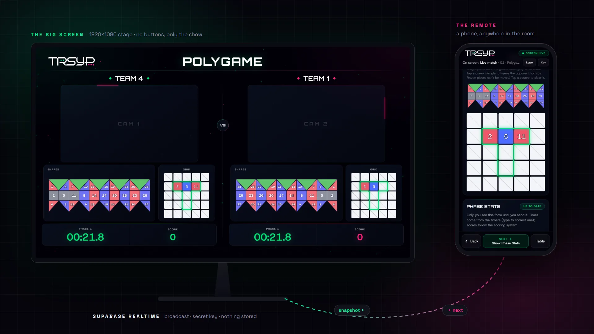</p>

<br>

Here is the night, in the order we played it.

## 🔧 00 · Homologation

Before any game, each robot was checked against the technical specs and given **0 to 50 points**. The scores were
typed on the phone while the logo was still up, then revealed together. They count up on screen and go straight into
the league table.

<p>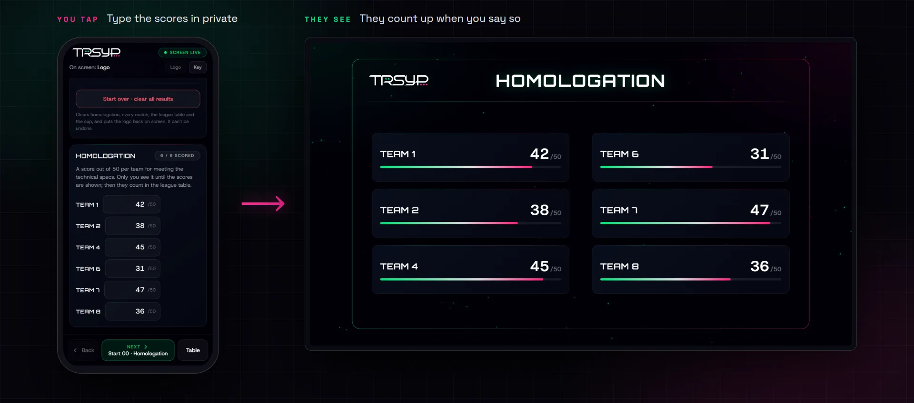</p>

<br>

## 🏁 The league

The teams met in three pairs. Each pair played **Polygame**, then **Garden**, and every point went into one league
table.

### 01 · Polygame

Two robots build the same shape on a 5×5 grid, using pieces from their board: red and blue **cubes** fill a square,
red and blue **triangles** fill half of one. The match is played in **three phases**, each with its own rule on which
pieces are allowed:

| Phase | Name | Pieces allowed |
|:---:|---|---|
| 1 | **Shape** | Any piece |
| 2 | **Parity** | Only pieces with a given parity |
| 3 | **Colour** | Only pieces of a given colour |

Every match opens on its **required shape**, shown big before the robots start.

<p>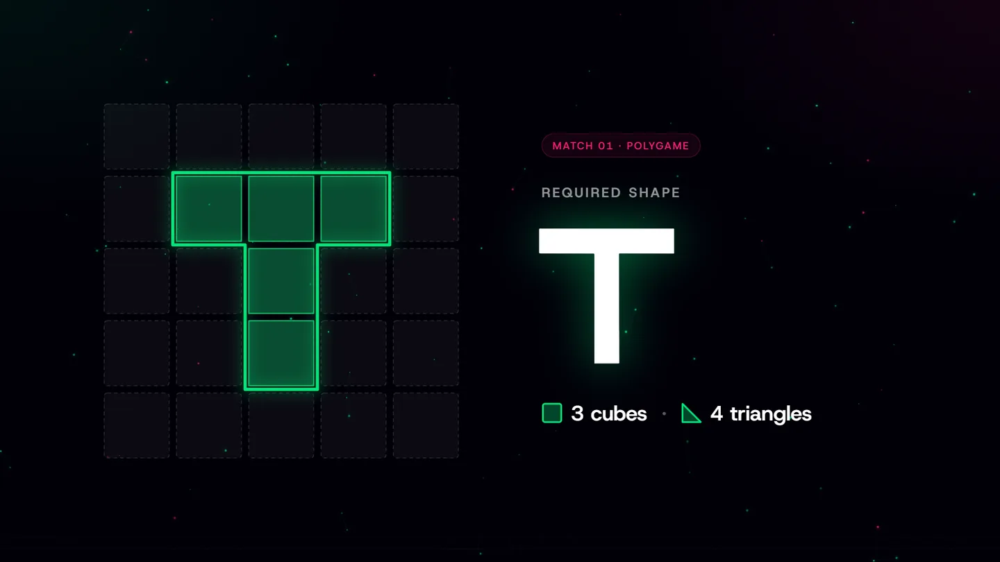</p>

<br>

Then, during the match, every piece a robot places is dragged on the phone from the team's board onto its grid. It
greys out on the board and lights up on the big screen, inside the outline of the required shape.

<p>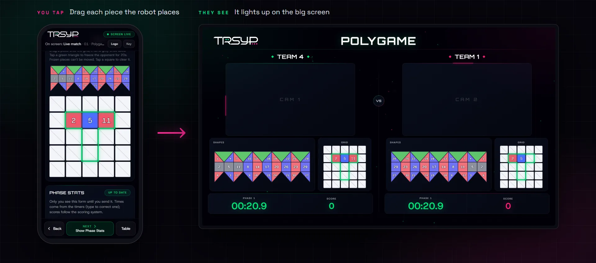</p>

<br>

Two moves to slow the other team down:

- **Green triangles** never go on the grid. Played, they **freeze the opponent's robot for 20 s**, after a
  5-second countdown on screen.
- **Pin:** when a robot is pinned, four of its unused pieces freeze for the rest of the match.

After each phase, the timers already know who finished first and in how long; the operator adds the jury's
accuracy. **Show** then draws the Phase Stats on screen, followed by the match score and the updated league table.

<p>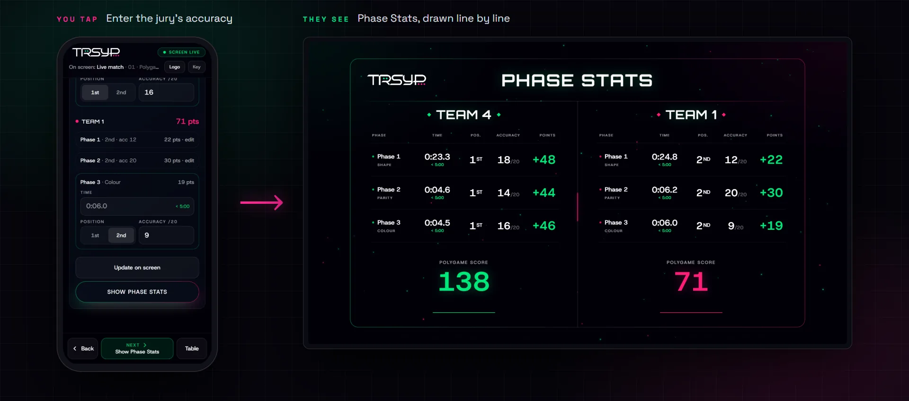</p>

<br>

### 02 · Garden

The same pairs, a new game. Each team has a limited number of **chances**, shown big on screen, and loses one at
every failed attempt.

<p>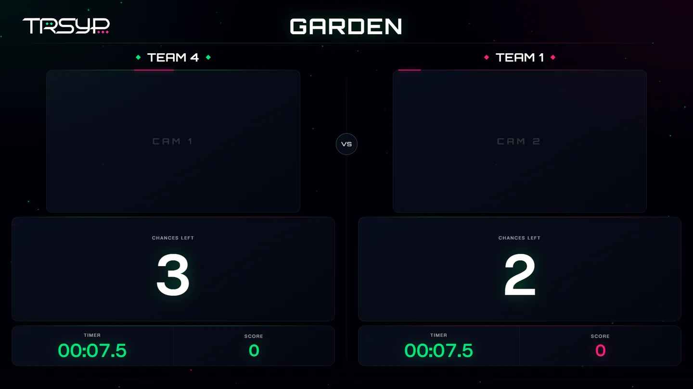</p>

<br>

At the end, the phone sets the position, which attempt worked, and the scans made out of order. The details come up
on screen, then the updated league table.

<p>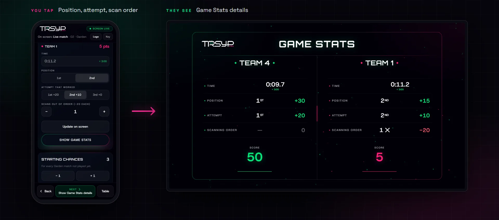</p>

<br>

## 🏆 The Champions Cup

After the league, the top four went to the cup, always **1st against 4th** and **2nd against 3rd**.

<p>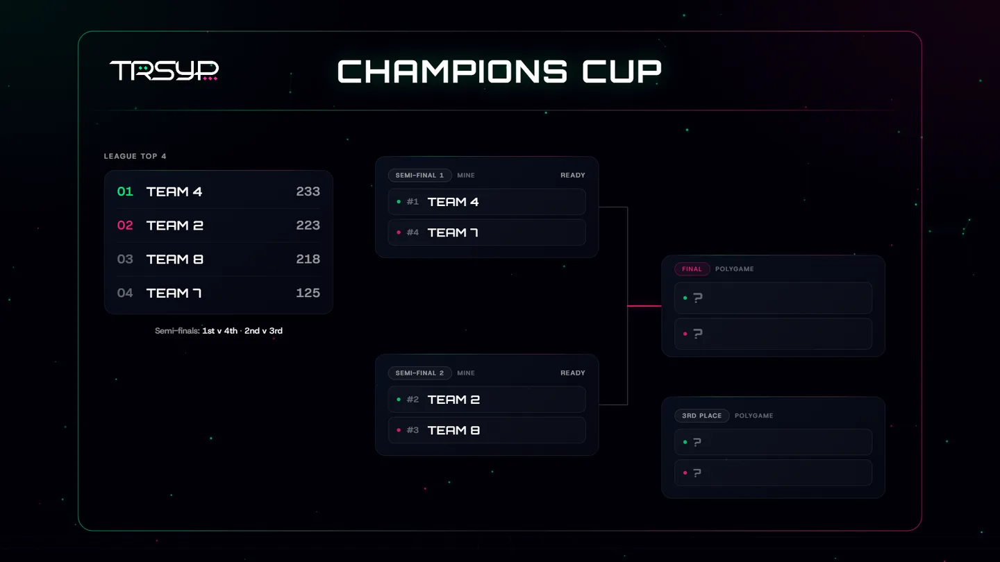</p>

<br>

### Semi-finals · Mine

Robots carry a cube across the field without touching the edges or the mines. Each team holds three **glitch cards**
to sabotage the other, each playable once per match:

| Card | Effect on the opponent |
|---|:---:|
| 📡 **Signal Jam** | 5 s |
| 🥽 **Blind Pilot** | 15 s |
| 🎮 **One Hand Control** | 15 s |

One tap on the phone, a five-second countdown on the big screen, then the glitch hits and the opponent's timer shows
how long it lasts.

<p>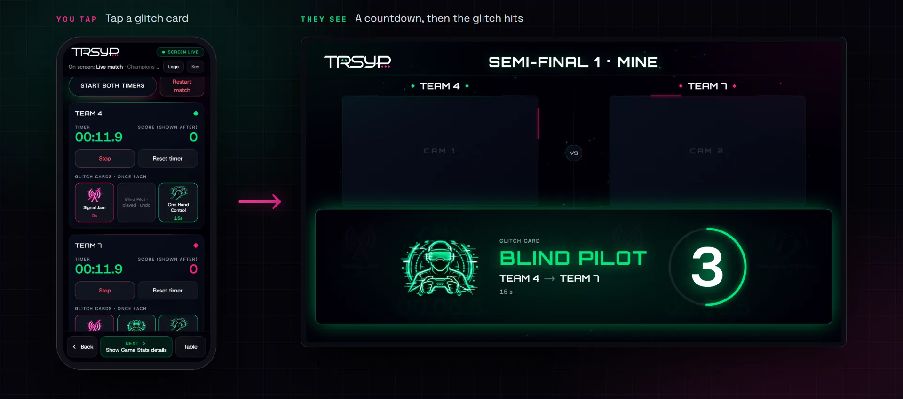</p>

<br>

### 3rd place and final · back to Polygame

The two last matches of the night went back to Polygame, with the same three phases and two new shapes: **Y** for
the 3rd place match and **P** for the final.

And with that, we had played Polygame five times: three league matches, the 3rd place match and the final. Put the
five required shapes side by side…

<p>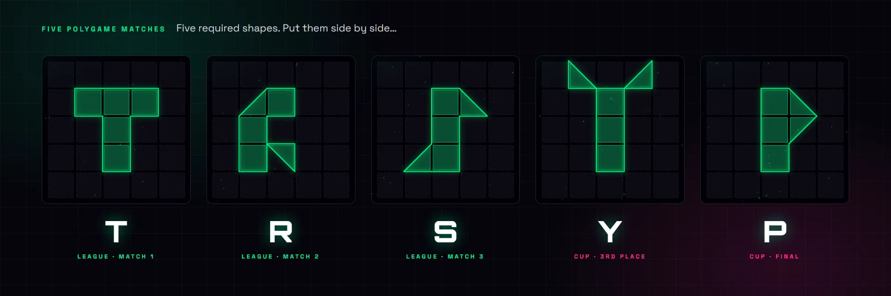</p>

<br>

<div align="center">
  <h3>…we finally did TRSYP, with shapes.</h3>
</div>

<br>

<p>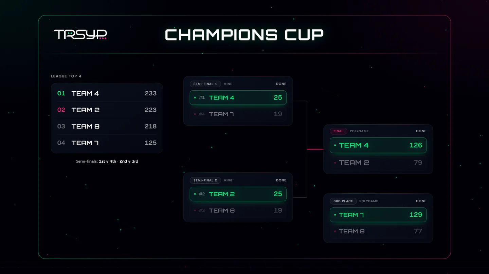</p>

<br>

<p>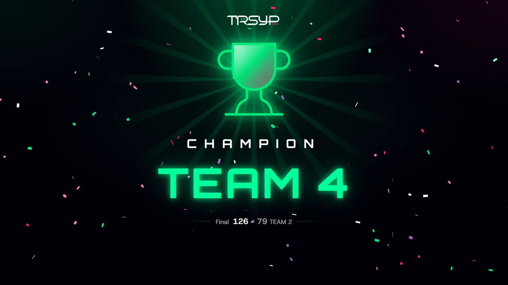</p>

<br>

## 🧮 Scoring

From the competition's scoring system, computed live in [`lib/scoring.ts`](lib/scoring.ts):

| Game | Finishing 1st / 2nd, on time | Finishing 1st / 2nd, late | Everything else |
|---|:---:|:---:|---|
| **Polygame**, per phase (limit 5:00) | 30 / 10 | 20 / 0 | accuracy, up to 20 |
| **Garden** (limit 3:00) | 30 / 15 | 15 / 0 | success on the 1st try +20, 2nd +10, 3rd 0 · each scan out of order −20 |
| **Mine** (limit 3:00) | 30 / 20 | 20 / 0 | edge contact −1 · cube drop −2 · mine contact −3 · crossing the unsafe line −30 |

Homologation adds 0 to 50 league points before the first game. A time nobody recorded counts as on time.

## 🔌 How it works

There is no backend. The two pages talk over a **Supabase Realtime broadcast channel**, and nothing is stored on
Supabase.

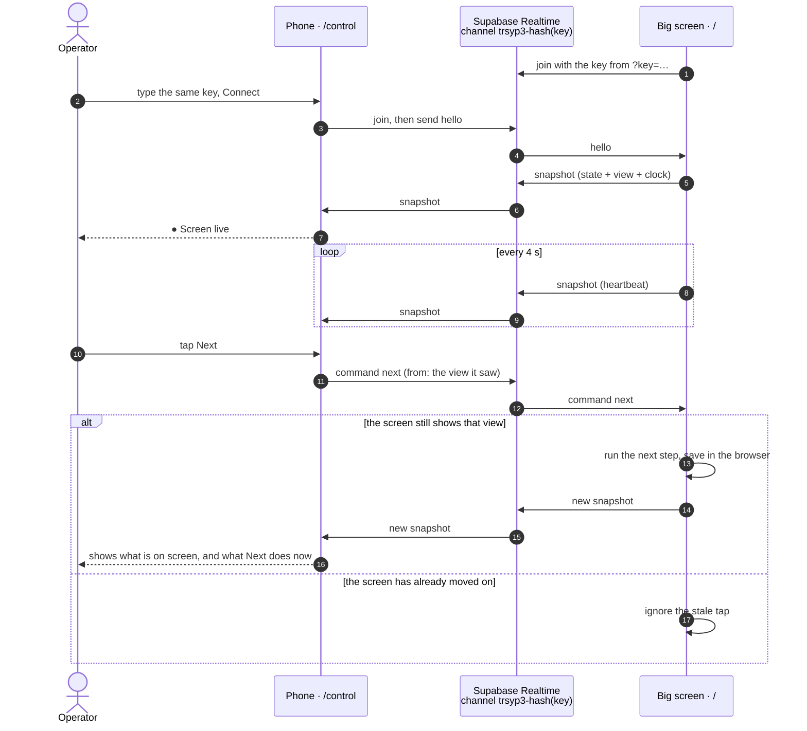

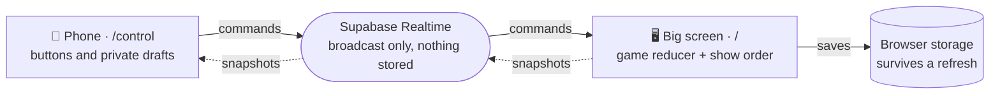

## 🚀 Running the show

```bash
pnpm install
pnpm build && pnpm start       # pnpm dev works too
```

`.env.local` needs `NEXT_PUBLIC_SUPABASE_URL` and `NEXT_PUBLIC_SUPABASE_ANON_KEY` (the public anon key only). In dev,
the app accepts requests from every local IPv4 address of the PC, so a phone on the same Wi-Fi or hotspot can open
the remote without any config.

1. On the screen PC, open `http://localhost:3000/?key=YOUR-KEY` once, then go full screen. The key is remembered.
2. On the phone, open `http://<PC's IP>:3000/control`, type the same key and press **Connect**.
3. The phone's header turns to **● Screen live**. From there, it's Next all the way.

<details>
<summary><b>Keyboard backup on the screen PC</b></summary>

| Keys | Action |
|---|---|
| <kbd>→</kbd> <kbd>←</kbd> | Next / back |
| <kbd>Home</kbd> | Back to the logo |
| <kbd>Tab</kbd>, <kbd>Esc</kbd> | Show / hide the leaderboard |
| <kbd>Z</kbd> | From a match, back to the line-up |
| <kbd>Space</kbd> | Start both timers |
| <kbd>R</kbd> / <kbd>U</kbd> | Pin / unpin team 1 / team 2 (Polygame) |
| <kbd>E</kbd> <kbd>D</kbd> · <kbd>I</kbd> <kbd>J</kbd> | Team 1 / team 2 uses or gets back a chance (Garden) |
| <kbd>Shift</kbd> + <kbd>1</kbd>–<kbd>9</kbd> | Starting chances for every Garden match |
| <kbd>Shift</kbd> + <kbd>X</kbd> twice | Reset both boards, timers and points |

</details>

<details>
<summary><b>Project structure</b></summary>

```text
app/
├── page.tsx                The big screen
└── control/page.tsx        The remote
components/
├── PolygameScreen.tsx      The stage: every screen, transitions, keyboard, the link to the remote
├── control/Controller.tsx  The whole remote
└── …                       One component per screen (shape reveal, stats, leaderboard, bracket, champion)
lib/
├── game.ts                 Game state and its reducer: matches, boards, timers, league, cup
├── flow.ts                 What Next does from any screen
├── scoring.ts              The scoring system
├── shapes.ts               The five required shapes
└── remote.ts               The Realtime link: key, channel, commands and snapshots
```

</details>

---

Part of TRSYP 3.0, with the [main platform](https://github.com/IEEE-INSAT/TRSYP3.0) and its [admin portal](https://github.com/MakkiAloulou/TRSYP3.0-Admin-Portal).

<br>

<div align="center">
  <sub>IEEE INSAT Student Branch × IEEE RAS Tunisia Section · TRSYP 3.0 · 2026</sub>
</div>
